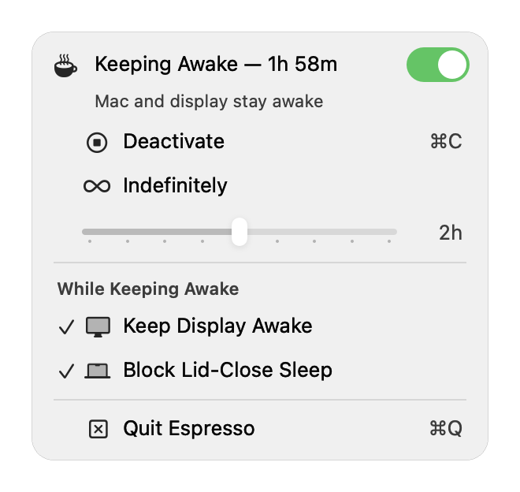

# Espresso ☕

A tiny native macOS menu bar app that keeps your Mac awake — like `caffeinate`
or Amphetamine, minus everything you don't need.



## Features

- **Native everything**: an `NSStatusItem` in the menu bar (steaming-cup SF
  Symbol while active) with a real `NSMenu` — no Dock icon, no windows,
  no Electron, no subprocesses. One ~1 MB binary.
- **Sessions**: keep the Mac awake indefinitely, or drag the slider to a
  timed session (15 min – 24 h; drag to preview, release to start — the menu
  stays open and the header flips to a live countdown). Timed sessions end
  themselves; the last slider position is remembered. A switch in the
  header toggles the session Control-Center-style, and the row below it
  names the action — "Keep Awake for 2h" when idle, "Deactivate" while
  running (⌘C while the menu is open).
- **Honest status header**: while off it shows live "Display sleeps in … ·
  Mac in …" countdowns computed from your actual power settings — and names
  the apps (in a tooltip) if something else is holding the Mac awake. While
  on it shows the session countdown and the display policy.
- **Keep Display Awake** (checked by default): uncheck to let the display
  sleep while the system stays awake (`caffeinate -i` behavior). Remembered.
- **Block Lid-Close Sleep** (checked by default): while a session runs — on
  AC or battery — closing the lid doesn't sleep the Mac, so you can unplug
  and carry it without dropping downloads or SSH sessions. Remembered; see
  the guardrails below.
- **Low Power Mode aware**: turning on Low Power Mode ends the running
  session — asking the Mac to conserve wins over keeping it awake.
  (Starting a session while Low Power Mode is already on still works.)

## Build & run

Requires macOS 13+ and the Xcode command line tools.

```bash
./make-app.sh
open build/Espresso.app
```

The bundle is ad-hoc signed. To start Espresso at login, add it in
System Settings → General → Login Items.

## Scripting

`--activate [minutes]` starts a session at launch:

```bash
open build/Espresso.app --args --activate 30   # keep awake for 30 minutes
open build/Espresso.app --args --activate      # keep awake indefinitely
open build/Espresso.app --args --activate --no-block-lid   # session without the lid block
open build/Espresso.app --args --activate --block-lid      # force the lid block even if unchecked
```

Verify what Espresso is holding:

```bash
pmset -g assertions | grep Espresso
pmset -g | grep -E "sleep|SleepDisabled"
```

## How it works

- Keeping awake is a single IOKit power assertion
  (`PreventUserIdleDisplaySleep`, or `PreventUserIdleSystemSleep` when the
  display is allowed to sleep) — exactly what `caffeinate` uses. It blocks
  *idle* sleep only and is released the instant the session ends.
- Lid-close sleep is a *forced* sleep no assertion can veto, so **Block
  Lid-Close Sleep** uses the root-only global flag `pmset disablesleep 1` —
  the same mechanism as Amphetamine Enhancer's Closed-Display Mode.

## Lid-block guardrails

The `SleepDisabled` flag is system-global and outlives the process, so
Espresso is strict about it:

- Engages only while a session is running; releases when the session ends,
  when the app quits, and when **Low Power Mode** turns on (enabling Low
  Power Mode ends the session). On battery the block stays armed by design —
  that's the unplug-and-carry case — so a lid-closed Mac in a bag keeps
  running until the session ends, you enable Low Power Mode, or the battery
  reaches the OS's critical-level forced shutdown. Timed sessions and Low
  Power Mode are your friends here.
- Espresso only sets the flag when it can also *clear* it unattended: it
  requires passwordless `sudo -n` and never falls back to a password dialog
  that could go unanswered overnight. Without passwordless sudo it refuses,
  with instructions to add a scoped rule:

  ```bash
  echo "$USER ALL=(root) NOPASSWD: /usr/bin/pmset disablesleep 0, /usr/bin/pmset disablesleep 1" | sudo tee /etc/sudoers.d/espresso-lidsleep
  ```

- If Espresso is killed un-cleanly while engaged, it clears the leftover
  flag at next launch; `sudo pmset disablesleep 0` (or a reboot) also
  restores normal lid behavior.
- While a session is active the menu checkmark shows the *actual*
  engagement state, so a failed engage is visible, never assumed.

## Notes

- Without the lid block, closing the lid sleeps the Mac (as with
  `caffeinate`). macOS clamshell mode (external display + AC + external
  keyboard/mouse) needs no software at all.
- The menu screenshot above is rendered from the app's own UI components;
  your menu may differ slightly by macOS version.

## License

MIT
